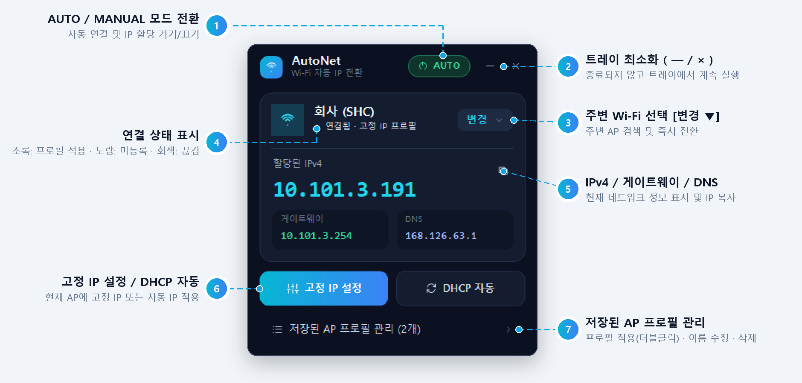
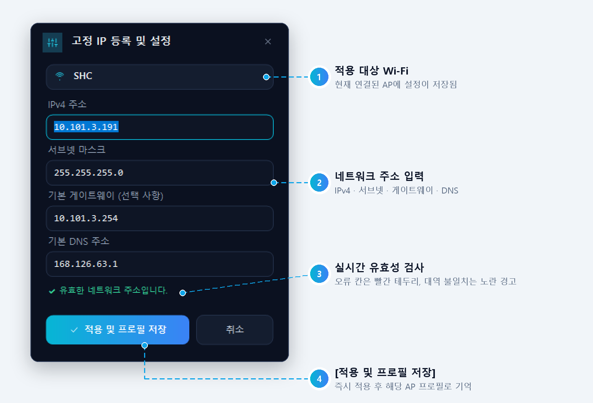
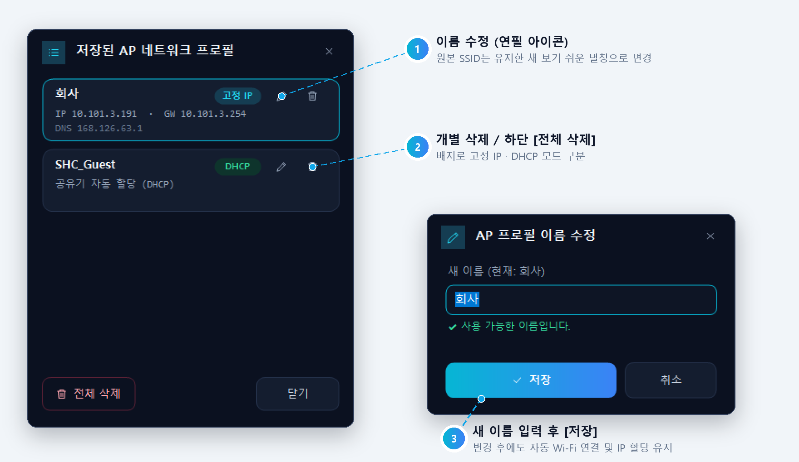
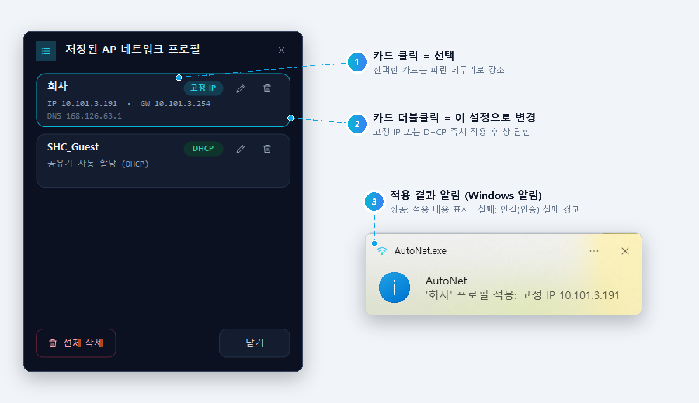
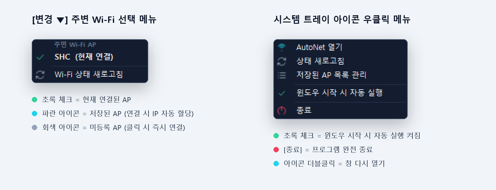

# 📘 AutoNet (Wi-Fi 자동 고정 IP 전환기)

**AutoNet**은 연결되는 Wi-Fi(공유기 AP)에 따라 미리 지정해 둔 **고정 IP / 서브넷 마스크 / 게이트웨이 / DNS** 또는 **DHCP(자동 할당)** 설정을 자동으로 연결·전환해 주는 Windows 경량 유틸리티입니다.

> 📖 전체 사용 매뉴얼(v2.2): [사용_매뉴얼.md](./사용_매뉴얼.md) · 단일 파일 웹 버전 [사용_매뉴얼.html](./사용_매뉴얼.html)

---

## 1. 설치 및 첫 실행 (다른 PC로 이동 시 포함)

1. **`AutoNet.exe` 단일 파일 실행**
   - 별도의 설치 과정 없이 `AutoNet.exe` 파일 하나만 원하는 폴더(바탕화면 등)에 복사하여 실행하면 됩니다.
2. **관리자 권한 승인**
   - 네트워크 어댑터의 IP 설정을 제어하기 위해 첫 실행 시 관리자 권한(UAC) 창이 나타나면 **[예]**를 클릭합니다.
3. **윈도우 시작 시 자동 실행 (자동 등록)**
   - 어떤 PC에서든 **처음 한 번만 실행하면 윈도우 시작프로그램 및 작업 스케줄러에 자동 등록**됩니다.
   - 이후 PC를 재부팅하면 창을 띄우지 않고 우측 하단 **시스템 트레이(시계 옆)**에서 조용히 자동 실행됩니다.

---

## 2. 메인 화면 구성



| 번호 | 영역 | 기능 설명 |
| :---: | :--- | :--- |
| **①** | **`AUTO` / `MANUAL` 모드 전환** | 상단의 둥근 버튼을 클릭하여 자동 Wi-Fi 연결 및 IP 할당 모드(초록색 `AUTO`)와 수동 모드(회색 `MANUAL`)를 전환합니다. |
| **②** | **트레이 최소화 (`—` / `×`)** | 클릭해도 프로그램이 종료되지 않고 **시스템 트레이로 숨겨져** 백그라운드에서 계속 동작합니다. |
| **③** | **주변 Wi-Fi 선택 (`[변경 ▼]`)** | 주변 Wi-Fi AP 목록을 스캔하여 다른 Wi-Fi로 즉시 연결하거나 상태를 새로고침합니다. |
| **④** | **연결 상태 표시** *(신규)* | 현재 AP 이름 아래에 색상 점과 문구로 연결 상태를 알려줍니다. (아래 표 참고) |
| **⑤** | **IPv4 / 게이트웨이 / DNS** | 현재 할당된 **IPv4 주소**를 크게 표시하고, **게이트웨이**와 **DNS**를 아래 두 칸에 나누어 보여줍니다. 우측 복사 아이콘으로 IP를 클립보드에 복사합니다. |
| **⑥** | **`[고정 IP 설정]` / `[DHCP 자동]`** | 현재 연결된 Wi-Fi에 고정 IP를 설정하거나 공유기 자동 할당(DHCP) 모드로 즉시 전환합니다. |
| **⑦** | **`[저장된 AP 프로필 관리 (N개)]`** | 등록된 AP 프로필 목록을 열어 설정을 바로 적용(카드 더블클릭)하거나 이름(별칭)을 수정·삭제합니다. |

### 연결 상태 표시 (④) 의미

| 표시 | 문구 | 의미 |
| :---: | :--- | :--- |
| 🟢 초록 | `연결됨 · 고정 IP 프로필` / `연결됨 · DHCP 프로필` | 저장된 AP에 연결되어 해당 프로필 설정이 적용된 상태입니다. |
| 🟡 노랑 | `연결됨 · 미등록 AP` | Wi-Fi에는 연결되었지만 저장된 프로필이 없는 AP입니다. 필요하면 **[고정 IP 설정]**으로 등록하세요. |
| ⚪ 회색 | `Wi-Fi 연결 안 됨` | Wi-Fi가 끊긴 상태입니다. 주변에 저장된 AP가 있으면 자동으로 연결을 시도합니다. |

> 💡 저장된 AP에 별칭을 붙인 경우 상단에는 **별칭**이 표시됩니다. (예: `사무실_장비망`)

---

## 3. 주요 기능 사용 방법

### ① 특정 Wi-Fi에 고정 IP 등록하기



1. 고정 IP를 사용할 Wi-Fi에 먼저 연결한 뒤 메인 화면에서 **[고정 IP 설정]** 버튼을 클릭합니다.
2. **① 적용 대상 Wi-Fi 확인**: 창 상단에 설정이 저장될 현재 AP 이름이 표시됩니다.
3. **② 네트워크 주소 입력**: **IPv4 주소**, **서브넷 마스크**(`255.255.255.0`), **기본 게이트웨이**(선택), **기본 DNS**(`8.8.8.8`)를 입력합니다. 선택한 입력칸은 파란 테두리로 표시됩니다.
4. **③ 실시간 유효성 검사**: 형식이 잘못된 칸은 **빨간 테두리**로, IP와 게이트웨이의 대역이 다르면 **노란 테두리와 경고 문구**로 즉시 알려줍니다. 오류가 있으면 저장 버튼이 비활성화됩니다.
5. **④ `[적용 및 프로필 저장]`**: 클릭 즉시 네트워크에 고정 IP가 적용되며, 해당 Wi-Fi AP 프로필로 자동 기억됩니다. 취소하려면 **[취소]** 또는 `Esc` 키를 누릅니다.

---

### ② 일반 공유기에서 자동 IP(DHCP) 사용하기
1. 해당 Wi-Fi에 연결된 상태에서 메인 화면의 **[DHCP 자동]** 버튼을 클릭합니다.
2. 즉시 공유기 자동 할당(DHCP) 모드로 복원되며, 이후 해당 Wi-Fi에 연결될 때마다 자동으로 DHCP 모드로 전환됩니다.

---

### ③ 저장된 AP 프로필 관리 및 이름(별칭) 수정하기



1. 메인 화면 하단의 **[저장된 AP 프로필 관리]** 를 클릭합니다.
2. 각 프로필 카드에는 AP 이름, **모드 배지**(파란색 `고정 IP` / 초록색 `DHCP`), IP·게이트웨이·DNS 정보가 표시됩니다.
   - 카드를 **더블클릭**하면 그 설정으로 바로 전환됩니다. (아래 ④ 참고)
3. **① 이름 수정**: 카드의 **연필 아이콘**을 클릭하면 이름 수정 창이 열립니다.
4. **② 삭제**: 카드 우측의 **휴지통 아이콘**으로 개별 삭제하거나, 하단 **[전체 삭제]**로 모든 프로필을 초기화할 수 있습니다.
5. **③ 새 이름 저장**: 알아보기 쉬운 이름(예: `사무실_장비망`)을 입력하고 **[저장]**(또는 `Enter`)을 누릅니다. 사용할 수 없는 이름이면 입력칸이 빨간 테두리로 바뀌고 이유가 표시됩니다.
   - *참고: 표시 이름을 변경해도 내부적으로 원래 공유기의 실제 SSID를 기억하므로, 자동 Wi-Fi 연결 및 자동 IP 할당이 그대로 작동합니다.*

---

### ④ 저장된 프로필로 바로 전환하기 (더블클릭)



1. **[저장된 AP 프로필 관리]**를 열고 원하는 프로필 카드를 **클릭**하면 파란 테두리로 선택됩니다.
2. 선택한 카드를 **더블클릭**하면 그 프로필의 고정 IP 또는 DHCP 설정이 즉시 적용되고 창이 닫힙니다. `MANUAL` 모드에서도 동작합니다.
   - **지금 연결된 Wi-Fi의 프로필**이면 바로 적용합니다.
   - **다른 Wi-Fi의 프로필**이면 먼저 그 Wi-Fi에 연결하고, **인증까지 완료된 것을 확인한 뒤**(최대 15초) 적용합니다. 연결에 실패하면 다른 네트워크에 잘못된 IP가 들어가지 않도록 적용을 취소합니다.
3. **결과는 Windows 알림으로 표시됩니다.** 성공하면 `'회사' 프로필 적용: 고정 IP 10.101.3.191`처럼 적용 내용이, 실패하면 연결(인증) 실패 경고가 나타납니다.
   - *직접 연결하는 동안(약 18초)에는 자동 연결이 끼어들어 다른 저장 AP로 바꾸지 않습니다.*

---

### ⑤ 주변 Wi-Fi 전환 및 시스템 트레이 완전 종료



- **주변 Wi-Fi 전환 (`[변경 ▼]`)**: 주변에서 검색된 다른 Wi-Fi를 클릭하면 즉시 연결을 시도하며, 저장된 AP인 경우 연결 직후 고정 IP(또는 DHCP)까지 자동 할당합니다.
  - 초록 체크 = 현재 연결된 AP · 파란 아이콘(`· 저장됨`) = 저장된 AP · 회색 아이콘 = 미등록 AP
- **창 다시 열기**: 우측 하단 시스템 트레이의 **AutoNet 아이콘을 더블클릭**하거나 우클릭 → **[AutoNet 열기]**를 클릭합니다.
- **자동 실행 켜기/끄기**: 트레이 아이콘 우클릭 → **[윈도우 시작 시 자동 실행]** 클릭 (켜져 있으면 왼쪽에 **초록 체크**가 표시됩니다)
- **프로그램 완전 종료**: 상단 `×` 버튼은 트레이 최소화이므로, 프로그램을 완전히 끄려면 **트레이 아이콘 우클릭 → `[종료]`**(빨간 전원 아이콘)를 선택합니다.

---

## 4. 빌드 방법

별도의 Visual Studio 설치 없이 Windows 기본 내장 .NET Framework C# 컴파일러(`csc.exe`)로 즉시 빌드할 수 있습니다.

```bat
build.bat
```

