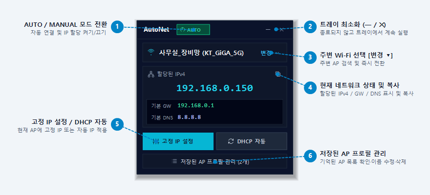
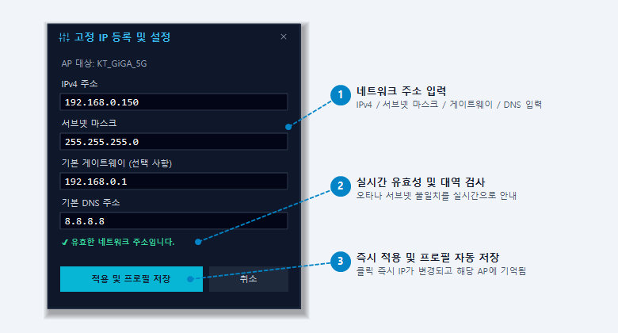
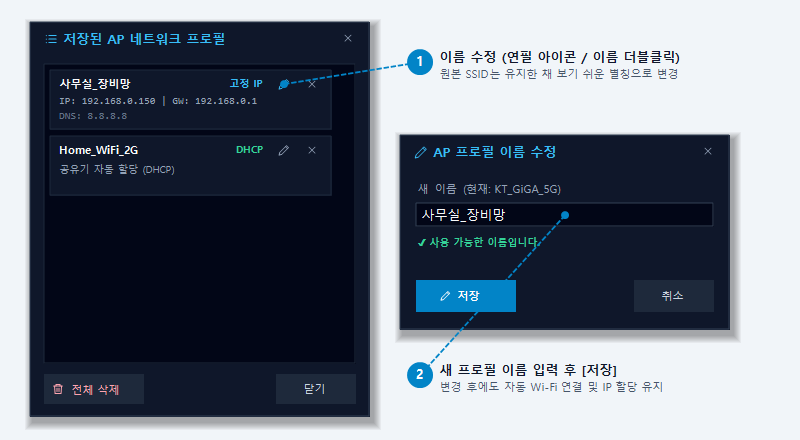
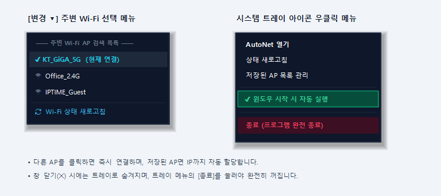

# 📘 AutoNet (Wi-Fi 자동 고정 IP 전환기) 사용 매뉴얼

**AutoNet**은 연결되는 Wi-Fi(공유기 AP)에 따라 미리 지정해 둔 **고정 IP / 서브넷 마스크 / 게이트웨이 / DNS** 또는 **DHCP(자동 할당)** 설정을 자동으로 연결·전환해 주는 프로그램입니다.

---

## 1. 설치 및 첫 실행 (다른 PC로 이동 시 포함)

1. **`AutoNet.exe` 단일 파일 실행**
   - 별도의 설치 과정 없이 `AutoNet.exe` 파일 하나만 원하는 폴더(바탕화면 등)에 복사하여 실행하면 됩니다.
2. **관리자 권한 승인**
   - 네트워크 어댑터의 IP 설정을 제어하기 위해 첫 실행 시 관리자 권한(UAC) 창이 나타나면 **[예]**를 클릭합니다.
3. **윈도우 시작 시 자동 실행 (자동 등록)**
   - 어떤 PC에서든 **처음 한 번만 실행하면 윈도우 시작프로그램 및 작업 스케줄러에 자동 등록**됩니다.
   - 이후 PC를 재부팅하면 창을 띄우지 않고 우측 하단 **시스템 트레이(시계 옆)**에서 조용히 자동 실행됩니다.

---

## 2. 메인 화면 구성

| 번호 | 영역 | 기능 설명 |
| :---: | :--- | :--- |
| **①** | **`AUTO` / `MANUAL` 모드 전환** | 클릭하여 자동 Wi-Fi 연결 및 IP 할당 모드를 켜거나(`AUTO`) 수동 모드(`MANUAL`)로 전환합니다. |
| **②** | **트레이 최소화 (`—` / `✕`)** | 클릭해도 프로그램이 종료되지 않고 **시스템 트레이로 숨겨져** 백그라운드에서 계속 동작합니다. |
| **③** | **주변 Wi-Fi 선택 (`[변경 ▾]`)** | 주변 Wi-Fi AP 목록을 스캔하여 다른 Wi-Fi로 즉시 연결하거나 상태를 새로고침합니다. |
| **④** | **현재 네트워크 상태 및 복사** | 현재 할당된 **IPv4 주소**, **기본 게이트웨이(GW)**, **기본 DNS**를 실시간 표시하며 복사 아이콘으로 IP를 클립보드에 복사합니다. |
| **⑤** | **`[고정 IP 설정]` / `[DHCP 자동]`** | 현재 연결된 Wi-Fi에 고정 IP를 설정하거나 공유기 자동 할당(DHCP) 모드로 즉시 전환합니다. |
| **⑥** | **`[저장된 AP 프로필 관리]`** | 등록된 AP 프로필 목록을 확인하고, 프로필 이름(별칭)을 수정하거나 삭제합니다. |

---

## 3. 주요 기능 사용 방법

### ① 특정 Wi-Fi에 고정 IP 등록하기

1. 고정 IP를 사용할 Wi-Fi에 먼저 연결한 뒤 메인 화면에서 **[고정 IP 설정]** 버튼을 클릭합니다.
2. **① 네트워크 주소 입력**: **IPv4 주소**, **서브넷 마스크**(`255.255.255.0`), **기본 게이트웨이**, **기본 DNS**(`8.8.8.8`)를 입력합니다.
3. **② 실시간 유효성 검사**: 주소 형식 오류나 게이트웨이 서브넷 대역 불일치 여부를 하단에 실시간으로 안내합니다.
4. **③ `[적용 및 프로필 저장]`**: 클릭 즉시 네트워크에 고정 IP가 적용되며, 해당 Wi-Fi AP 프로필로 자동 기억됩니다.

---

### ② 일반 공유기에서 자동 IP(DHCP) 사용하기
1. 해당 Wi-Fi에 연결된 상태에서 메인 화면의 **[DHCP 자동]** 버튼을 클릭합니다.
2. 즉시 공유기 자동 할당(DHCP) 모드로 복원되며, 이후 해당 Wi-Fi에 연결될 때마다 자동으로 DHCP 모드로 전환됩니다.

---

### ③ 저장된 AP 프로필 관리 및 이름(별칭) 수정하기

1. 메인 화면 하단의 **[저장된 AP 프로필 관리]** 버튼을 클릭합니다.
2. **① 이름 수정**: 각 프로필 카드의 **연필 아이콘 클릭** 또는 **AP 이름 더블클릭** 시 이름 수정 창이 열립니다.
3. **② 새 이름 저장**: 알아보기 쉬운 이름(예: `사무실_장비망`)을 입력하고 **[저장]**을 누릅니다.
   - *참고: 표시 이름을 변경해도 내부적으로 원래 공유기의 실제 SSID를 기억하므로, 자동 Wi-Fi 연결 및 자동 IP 할당이 그대로 작동합니다.*
4. **삭제**: 카드 우측의 **`✕` 버튼**으로 개별 삭제하거나, 하단 **[전체 삭제]**로 모든 프로필을 초기화할 수 있습니다.

---

### ④ 주변 Wi-Fi 전환 및 시스템 트레이 완전 종료

- **주변 Wi-Fi 전환 (`[변경 ▾]`)**: 주변에서 검색된 다른 Wi-Fi를 클릭하면 즉시 연결을 시도하며, 저장된 AP인 경우 연결 직후 고정 IP(또는 DHCP)까지 자동 할당합니다.
- **창 다시 열기**: 우측 하단 시스템 트레이의 **AutoNet 아이콘을 더블클릭**하거나 우클릭 → **[AutoNet 열기]**를 클릭합니다.
- **자동 실행 켜기/끄기**: 트레이 아이콘 우클릭 → **[윈도우 시작 시 자동 실행]** 클릭
- **프로그램 완전 종료**: 상단 `✕` 버튼은 트레이 최소화이므로, 프로그램을 완전히 끄려면 **트레이 아이콘 우클릭 → `[종료]`**를 선택합니다.

---

## 4. 설정 및 로그 파일 위치

프로그램의 프로필 데이터와 동작 로그는 윈도우 사용자 데이터 폴더에 안전하게 저장됩니다.
- **경로**: `%LocalAppData%\AutoNet` (`C:\Users\<사용자명>\AppData\Local\AutoNet`)
  - `autonet_profiles.txt`: 저장된 AP 프로필 및 고정 IP 설정 파일
  - `autonet.log`: 네트워크 감지 및 IP 전환 이력 로그
